# LandsFall ビルドガイド
自作キーボード「LandsFall」の組み立てキット購入者向けのビルドガイドです。

[!CAUTION]
- 組み立て作業では、基板の端を触れて怪我をしたり、はんだ付け作業で火傷を負ったり、接着剤が目に入る等の事故を防ぐため、必ず保護手袋（静電手袋推奨）、保護メガネを着用してください。組み立てに伴う怪我や事故の責任は負いかねますので、予めご了承ください。
- LandsFallで使用しているキースイッチ PG1316Sはキーキャップの交換を想定していないスイッチです。組み立てが問題なく進めばキーキャップの取り外しは発生しませんが、問題があった場合は必要なこともあります。キースイッチの特性上、取り外しに伴う商品の破損・故障は無償保証の対象外となりますので、ご了承ください。Booth注文履歴からご相談いただければ、リワークのフォローは可能ですのでお気軽にご連絡ください。

[!NOTE]
自己調達が必要な物品があります。
- XIAO nRF52840 Plus: 2pcs
- PG1316S専用 Kailh純正1U or 1U homingキーキャップ: 50pcs
- 金属/プラスチック対応の接着剤

## 1. キット内容を確認する
[!NOTE]
不足品や破損が見つかった場合は、Boothの注文履歴からお問い合わせください。

### 緑枠: 基板・ケース
到着時は簡易組み立てされた状態です。以下の手順で、左右両方を分解して不足や破損がないか確認ください。
1. トップカバーのテープを剥がす。
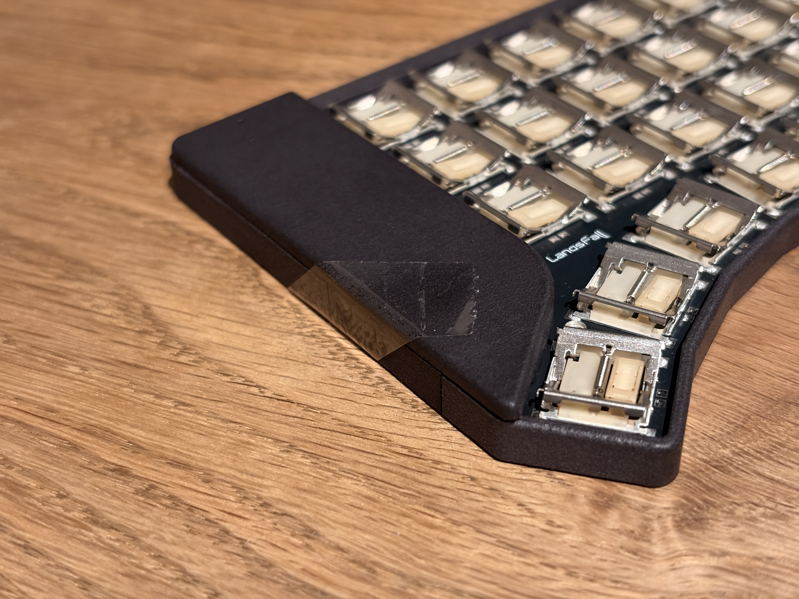

2. 電池ケース・電池基板を取り外す。

3. トップカバーを取り外す。
画像の方向にトップカバーを少しスライドさせ、真上に持ち上げる。
 

4. 基板をケースから取り出す。
画像の方向・順序でキースイッチが実装されているメイン基板を持ち上げ、ケースから取り出す。
 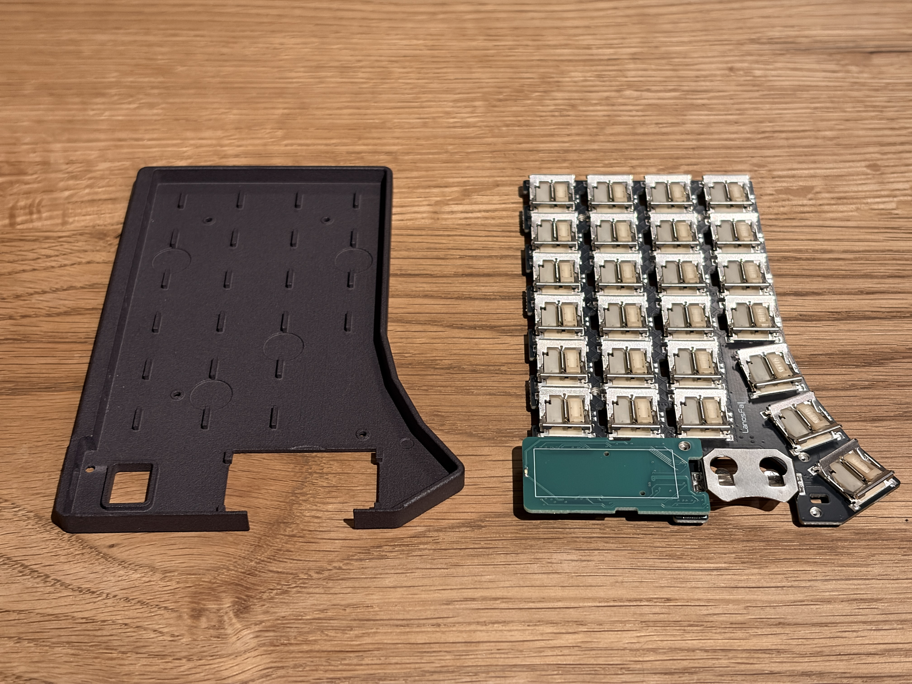

### 黄枠: タッチセンサー基板
2枚あることを確認する。

### 青枠: ネジ・その他
以下の部品が揃っていることを確認する。
- 磁石
  - φ10x1mm: 8pcs
  - φ3x2mm: 2pcs
- ネジ(各予備1コ付き)
  - 太・短(M1.6x3mm): 8+1pcs
  - 細・短(M1.2x3mm): 6+1pcs
  - 細・長(M1.2x5mm): 2+1pcs
- 滑り止めシート(約6x50mm, グレー): 1枚
- 吸音シート(フィルム付箋): 25x2枚

## 2. XIAO nRF52840 Plusのはんだ付け
緑色の基板にXIAO nRF52840 Plusを実装します。以下の手順を左右2回分行ってください。
基板に左右の区別はありません。

1. メイン基板から緑色のXIAO用基板を取り外す。
矢印の方向に真っ直ぐXIAO用基板を持ち上げ、コネクタを外します。

2. XIAO nRF52840 Plusの位置決めを行う。
基板のシルクを目印に、実装用パッドと合うようにXIAO nRF52840 Plusを配置します。
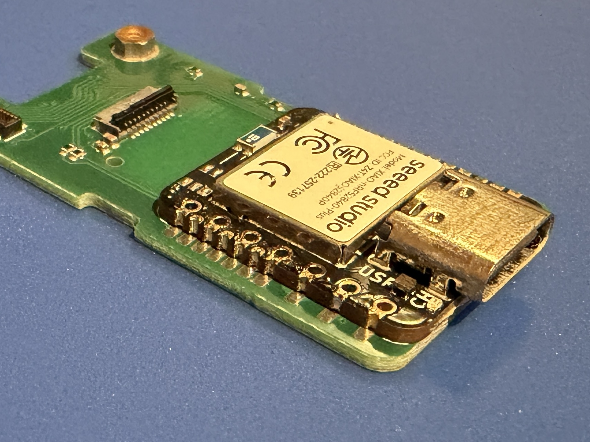

3. XIAO nRF52840 Plusをはんだ付けする。
まずは四隅のいずれかをはんだ付けし、位置を固定することで実装しやすくなります。

XIAO nRF52840 Plusの全ての側面端子をはんだ付けします。

https://github.com/user-attachments/assets/f41f2cdf-cf8f-4341-8282-2b132139bbb9

折り畳み: NG例
黄矢印はハンダ不足で導通しない可能性があります。
赤矢印はハンダ過多でパッド間がブリッジしています。
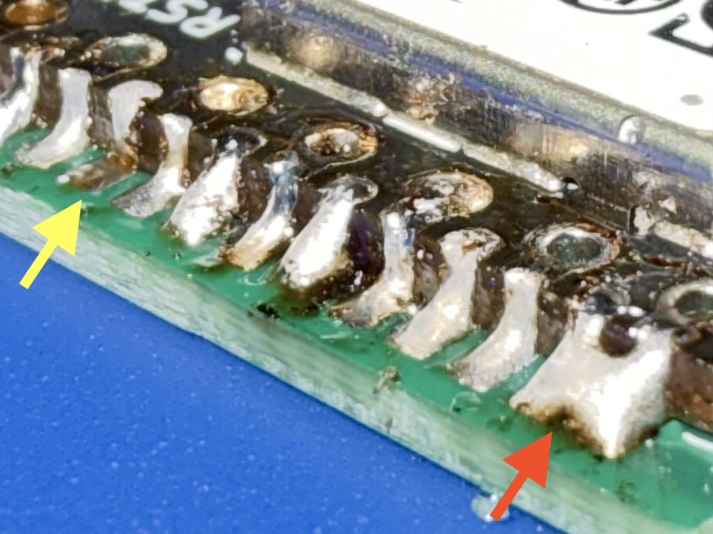

## 3. タッチセンサーの取り付け
キーキャップの裏面にタッチセンサーを取り付けます。
以下の手順をオーソリニア配列となっている44キー分繰り返してください。

1. タッチセンサーの親基板から子基板を切り離す。
動画のように白い剥離紙がついている側を先に切り離し、子基板の細い側に向かって取り外してください。

https://github.com/user-attachments/assets/fb06946d-4bcb-41b0-837e-7275ee3c5a9a

2. 切り離したタッチセンサーから剥離紙を剥がす。
剥離紙は後で使用するため、6枚以上を廃棄せず残してください。

https://github.com/user-attachments/assets/670d74a3-f58f-4339-be7a-0719ba9cc12a

3. キーキャップの裏面にタッチセンサーを仮止めする。
動画の向きにタッチセンサーの端がキーキャップ側壁にピッタリ沿う位置に配置し、粘着部分がキーキャップ裏面に完全に収まるように軽めの力で貼り付けてください。
1U homingキーキャップを使用される場合は、突起の向きを間違えないようにご注意ください。タッチセンサーの細い部分が飛び出していない側が、使用時の手前方向になります。
タッチセンサー基板の細い部分は約90°折り曲がる状態になります。

https://github.com/user-attachments/assets/6732cb8c-c12d-4693-bf88-934a42c0de7a

折り畳み: NG例
貼り付け位置がズレるとキーの押下やトラックパッドの操作ができなくなるので、ご注意ください。
失敗した場合は、剥がして再度貼り付けてください。
粘着剤が残ってしまったり、タッチセンサーが破損した場合は新しいものを使用してください。（数枚余分に同梱されています）
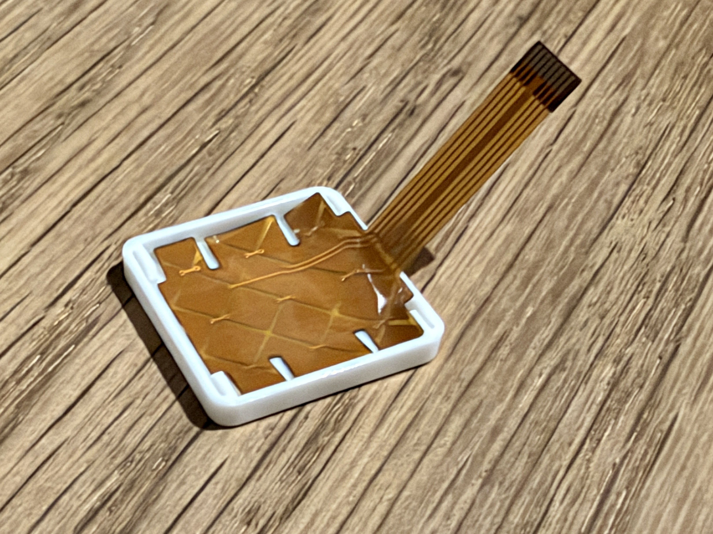

4. タッチセンサーを完全に貼り付ける。
木製の爪楊枝を使用して、タッチセンサーの四隅を中心に、キーキャップにしっかり密着させてください。

https://github.com/user-attachments/assets/e01d9a7d-bd10-44b0-b4d4-f7a53b401dd5

## 4. キーキャップの取り付け
以下の手順をオーソリニア配列となっている44キー分繰り返してください。

1. 吸音シート(フィルム付箋)を1枚取り、粘着面を外側に半分に折る。
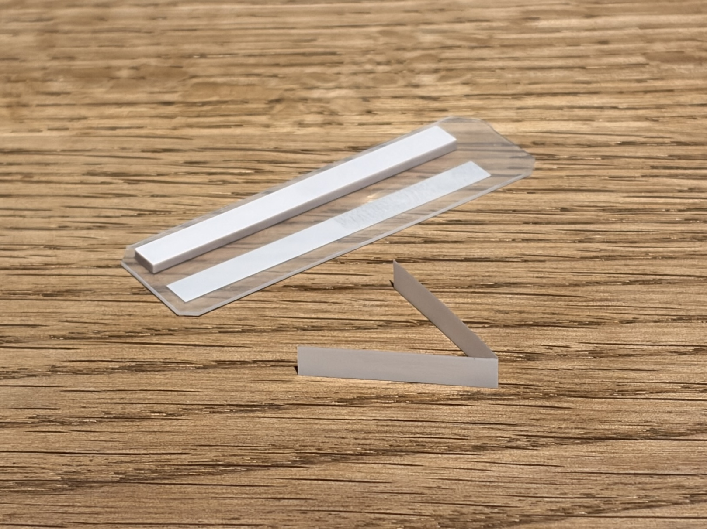

2. 折り曲げた吸音シートを半分にカットする。
折り曲がっている側だけを使用します。残りの切れ端は廃棄してください。

3. キーキャップに吸音シートを貼り付ける。
画像の向きに、キーキャップの中央付近に吸音シートを貼り付けてください。

4. キーキャップをメイン基板に取り付ける。
タッチセンサーの細い部分をキースイッチ上側の基板切り欠きに差し込み、吸音シートを巻き込まないように注意しながらキーキャップを押下して取り付けます。

https://github.com/user-attachments/assets/6ce605e7-47d3-441d-a133-7cb10b3fd03e

⚠️吸音シートを巻き込んだ状態で取り付けると、キーが反応しにくくなります。
|OK|NG例|
|---|---|
||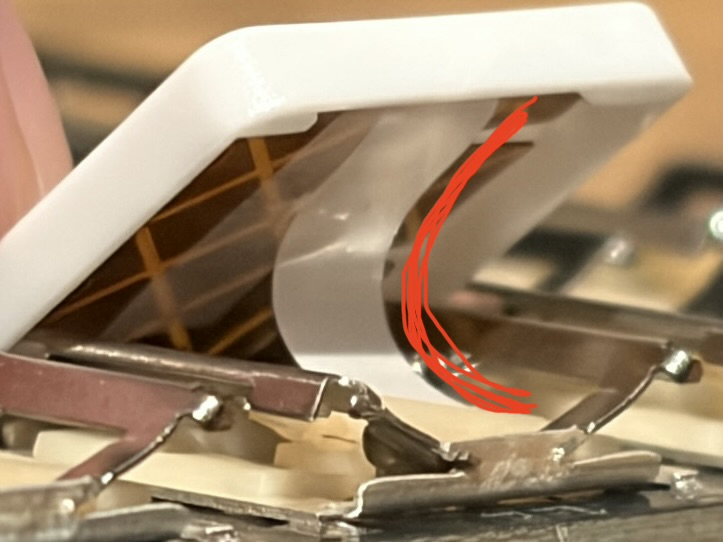|

5. タッチセンサーをメイン基板と接続する。
メイン基板背面のFPCコネクタのロックが上がった状態で、タッチセンサーをしっかり奥まで差し込み、そのままロックを下げて固定します。

https://github.com/user-attachments/assets/545d9d2c-6aa8-4b21-84b3-98e63c8cd9b2

[!WARNING]
FPCコネクタのロックを、FPCを差し込んでいない状態で繰り返し上げ下げしないようご注意ください。
コネクタが故障する可能性があります。

ここまでの手順で、オーソリニア配列部分のキーキャップ取り付けは完了です！

## 5. XIAO基板の取り付け
XIAO nRF52840 Plusを実装した基板を、最初に取り外したメイン基板のコネクタに取り付け、付属のネジ(細・短/M1.2x3mm)で固定してください。(左右両方とも固定してください)

## 6. 磁石の取り付け
1. **左右いずれか**のケースに磁石を取り付ける。
磁石を取り付ける位置(ケースの窪み部分)を確認します。

アロンアルファなどの接着剤を少量塗布して、磁石を窪みに収まるように接着します。
磁石の極性の向きはどちらでもOKです。

2. もう片方のケースにも磁石を取り付ける。
前の手順で取り付けた磁石の接着剤がある程度硬化した後、もう片方のケースが上になるように背面同士を重ねます。
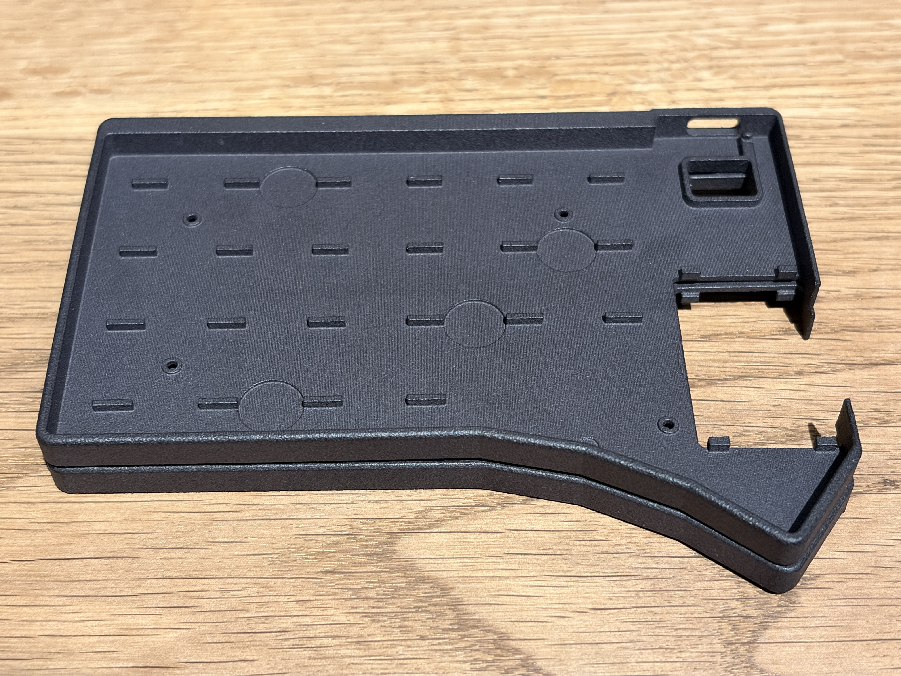

前の手順と同様に接着剤を塗布し、**最初に取り付けた側の磁石と吸着する向きに**φ10mmの磁石4pcsを接着してください。
φ3mmの小さな磁石はどちらの向きでもOKです。

3. 接着剤が乾くまで待つ。☕️

## 7. 基板のネジ止め
以下の手順を左右両方で行ってください。

1. 最初に取り外した時と逆の手順で、XIAO基板ネジ止め済みのメイン基板をケースに置く。
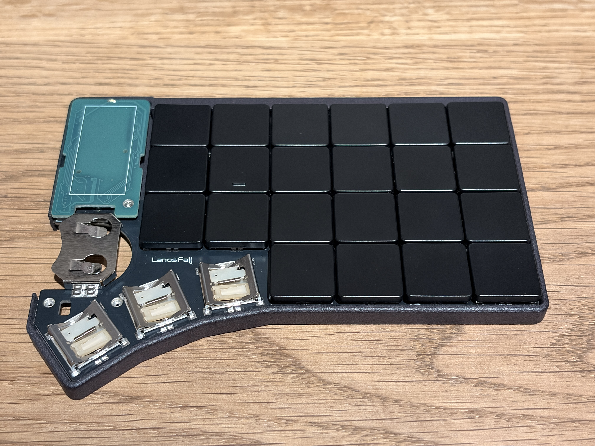

2. 基板が落下しないように注意しながら、ケースを裏返して付属のネジ(太・短/M1.6x3mm)4pcsでメイン基板とケースを固定する。

3. 電池基板をネジ止めする。
電池基板を画像の向きに配置してください。
緑丸マークの片側あたり2ヶ所に、付属のネジ(細・短/M1.2x3mm)で固定します。
赤丸マークにはネジを取り付けないでください。

## 8. トップカバーの取り付け
以下の手順を左右両方で行ってください。

1. 最初に取り外した時と逆の手順で、トップカバーを取り付ける。
カバー上端がケース上端から約1mm下になる位置に真上から嵌め込み、上方向にスライドさせて上端同士を合わせてください。
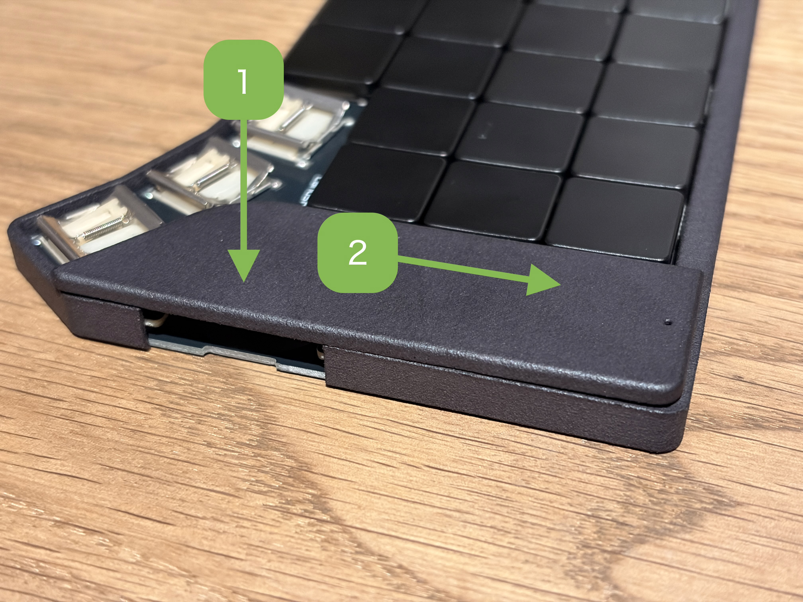
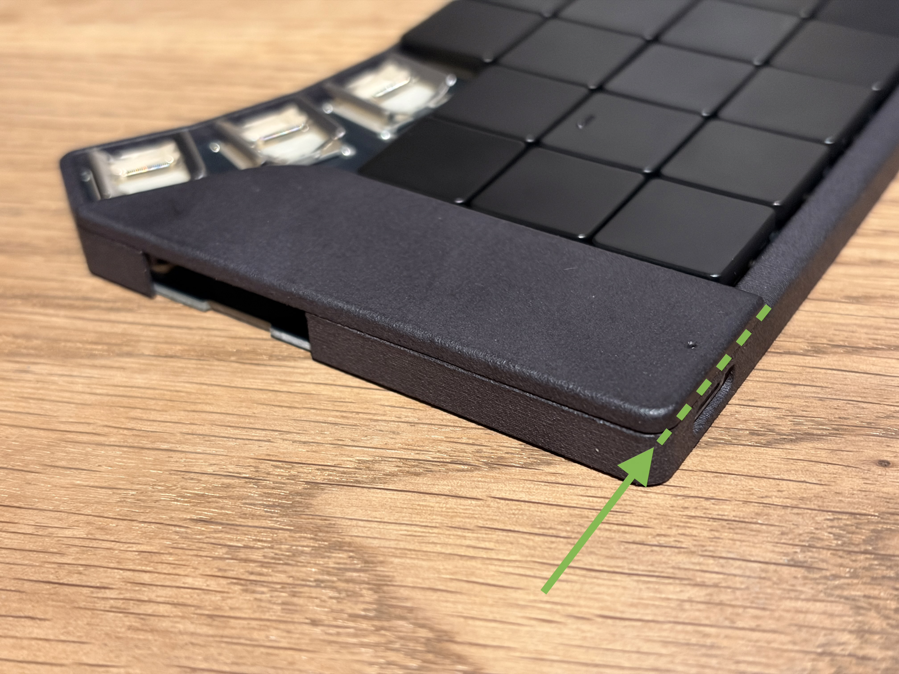

2. カバーをロックする。
前の手順で電池基板にネジを取り付けなかった箇所に、付属のネジ(細・長/M1.2x5mm)を取り付けます。
トップカバーが正しい位置に固定できていない場合、ネジが最後まで入らない・カバーが浮いてくることがあるため、無理な力で締め付けず様子を見ながら作業してください。
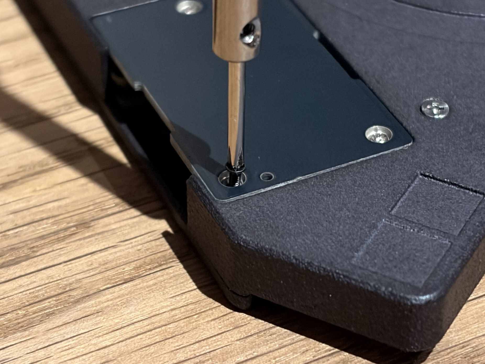

3. ネジ締め後、トップカバーを取り外す向きにスライドできなくなっていることを確認してください。

## 9. 滑り止めの貼り付け

1. 滑り止めシートをカットする。
付属の滑り止めシート(約6x50mm)を約6mmの間隔でカットし、8個に個片化してください。
定規とペンで事前に目盛りをつけておくことをおすすめします。

2. 滑り止めシートを貼り付ける。
ケース背面の四角形の窪みのうち、浅い方に滑り止めを貼り付けます。
貼り付け箇所をティッシュ等で清掃し、ゴミや埃を取り除いてください。

滑り止めシートの白い剥離紙を剥がして貼り付けてください。反対側の透明フィルムも剥がしてください。

## 10. 動作確認

1. ファームウェアをダウンロードする。
以下のリンクから2つの.uf2ファイルをお使いのPCにダウンロードしてください。
- 右手側をトラックパッドとして使う場合: [右手用ファームウェア](firmware/trackpad_right)
- 左手側をトラックパッドとして使う場合: [左手用ファームウェア](firmware/trackpad_left)

[!NOTE]
ファームウェアのリポジトリを後日公開予定です。

2. ファームウェアを書き込む(左右両方)。
PCとキーボードをUSBケーブルで接続し、ケース背面の穴に爪楊枝などを差し込みXIAO nRF52840 Plusのリセットスイッチを素早く2回押し、ブートローダーを起動します。
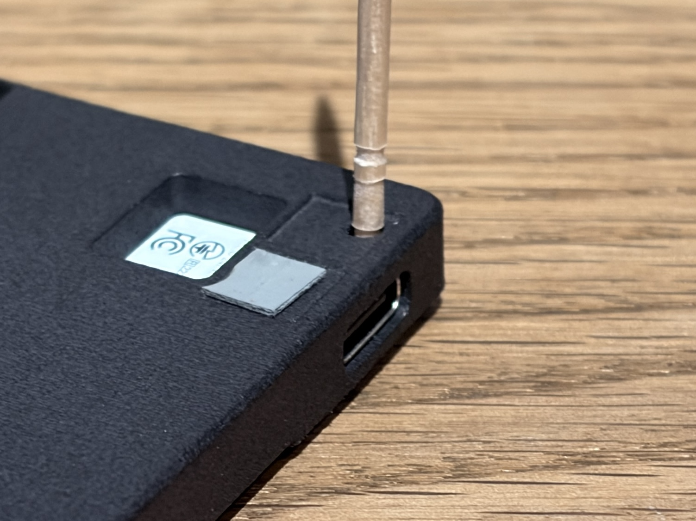

`XIAO-BOOT`というドライブ名がPCに認識されたら、ダウンロードした2つの.uf2ファイルのうち`left`と表記のあるものを左手側、`right`を右手側にコピー&ペーストしてください。
書き込みが終了するとドライブがアンマウントされるので、USBケーブルを取り外してください。

3. 電池を取り付ける(左右両方)。
CR2032をキーボード底面側がマイナス側になる向きで1つ挿入してください。
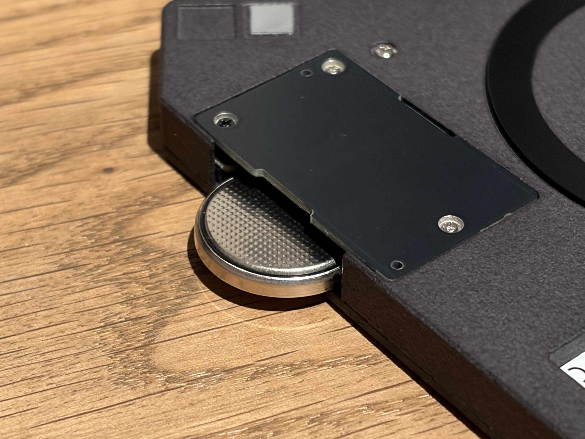

2つ目のCR2032を電池ホルダーに画像の向きで取り付け、キーボード底面側に1つ目の電池と重ねる形で挿入してください。
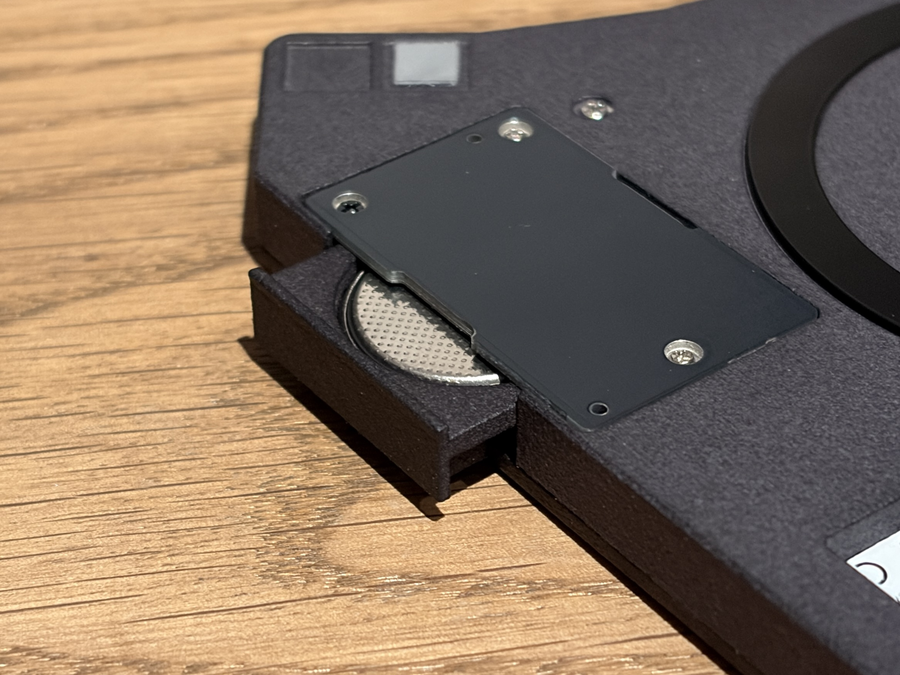

4. LandsFall専用設定ツール [LandsFall Harbour](https://chalan-175.github.io/LandsFall-Harbour/#/setup/keys) に接続する。
リンクをChromeまたはEdgeで開き、トラックパッド使用側をUSBケーブルでPCと接続してください。
画面の指示に従って接続し、初期設定ページを開いてください。
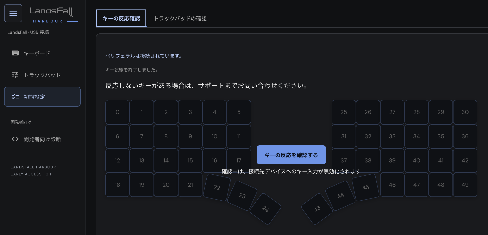

折り畳み: ペリフェラル未接続の警告が出る場合
ペリフェラル側はUSB電源供給せず、キーボードの背面同士をマグネット吸着させ少し待って離した後、ペリフェラル側のLEDを見てください。
- 数秒点滅してから約1.5秒おきに1回点滅する場合: 起動は問題ありません。[リセット用ファームウェア](firmware/settings-reset-xiao-ble-zmk.uf2)を左右両方に書き込み、他の電源が入ったXIAO nRF52840やZMK系キーボードが近くにない環境で、再度トラックパッド使用側に応じたファームウェアを書き込んでください。
- 数秒点滅してから完全消灯する場合: ペアリングは正常と思われます。LandsFall Harbourをリロードしたり、再接続しても改善しない場合は、Booth注文履歴からお問い合わせください。
- 全く点灯しない場合
  - USBケーブルを挿してPC or USB充電器に接続すると点滅する場合: 電池が正しい向きに入っているか確認してください。使いかけの電池の場合は、残量が少なく起動できない場合があるため、新品の電池を試してください。改善が見られない場合は、初期不良の可能性があるため、症状をBooth注文履歴からご連絡ください。
  - PCとUSBケーブルで有線接続しても変化がない場合
    - PCにUSBデバイスとして認識される場合: XIAO nRF52840 Plusのはんだ付け不良が疑われます。XIAO基板を取り出し、はんだ付け状況を確認してください。
    - PCにUSBデバイスとして認識されない場合: ファームウェアの書き込み失敗や、XIAO nRF52840 Plusの故障が疑われます。ファームウェアの再書き込みを行なっても改善しない場合、症状をBooth注文履歴からご連絡ください。

5. キーの反応確認を行う
"キーの反応確認"タブにアクセスし、すべてのキーを順に押下して✅マークがつくことを確認してください。
サムクラスタキーはキーキャップ未取り付けのため、怪我に注意しながらキースイッチを直接押下してください。

折り畳み: 反応しないキーがある場合
- 特定の行または列がすべて反応しない場合: XIAO nRF52840 Plusのはんだ付け不良の可能性があります。XIAO基板を取り外し、はんだ付け状況を確認してください。
- 特定のキーが反応しない場合: キーの押下感が他と異なる場合、キーキャップの取り付けに異常がある可能性があります。

6. トラックパッドのヘルスチェックを行う
"トラックパッドの確認"タブにアクセスし、オーソリニア配列部分のすべてのキーに✅マークがつくことを確認してください。

折り畳み: ✅マークがつかないキーがある場合

該当するキーのタッチセンサー基板がメイン基板と正常に接続できていない可能性があります。メイン基板を取り外し、背面のFPCコネクタにしっかりセンサー基板が挿さっているか・コネクタのロックが下がっているか確認してください。
タッチセンサー基板に破損が見られた場合は、キーキャップを取り外して予備のセンサー基板に交換してください。

7. トラックパッドの反応を確認する
LandsFall Harbourの初期設定ページから離れ、左右いずれかのサムクラスタキーの一番内側のキーを押した状態で、トラックパッド上で指を滑らせてPCの操作ができることを確認してください。
操作ができず、セントラル側のLEDが素早く点滅している場合は、サムクラスタキーを押したまトラックパッドから数秒指を離し、点滅が消えるか確認してください。
点滅が消えた状態で操作できれば問題ありません。

## 11. サムクラスタキーの取り付け

1. キーキャップを準備する(静音化のため)。
タッチセンサーを取り付けていない左右計6キーの裏面に、タッチセンサー基板の取り付け作業で出た剥離紙を置きます。

タッチセンサーの作業と同様に、吸音シートを剥離紙に貼り付けます。
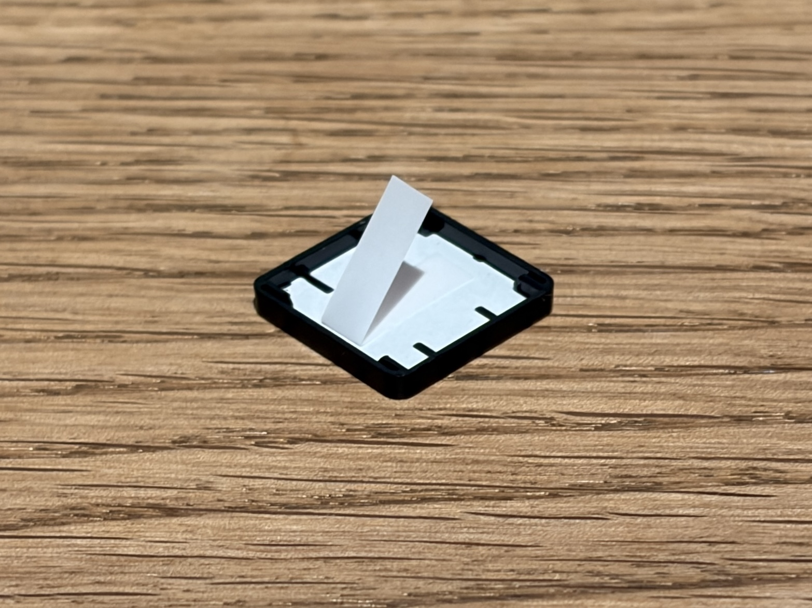

2. キーキャップを取り付ける。
タッチセンサーの作業時と同じ吸音シートの向きで、キーキャップを嵌め込んでください。

## 12. 完成！
おめでとうございます！これでLandsFallの組み立ては完了です！
LandsFall Harbourで、キーマップやトラックパッドの操作感をカスタムしてお楽しみください。
キーマップはZMK Studioでも編集可能です。

[!TIPS]
- LandsFallのトラックパッドは、レイヤー1,2を除く任意のレイヤーで有効化されます。デフォルトではレイヤー6,7で有効となります。
- トラックパッドの慣性スクロールやカーソル加速の設定は、非Windowsでのみ有効です。Windowsではタッチパッドとして認識され、感度やジェスチャーの設定はOS設定から行う必要があります。
