# LandsFall ビルドガイド

自作キーボード「LandsFall」の組み立てキット購入者向けのガイドです。開封時の部品確認から、組み立てと動作確認までを順に進めます。

> [!CAUTION]
> 基板の端でのけが、はんだ付けによるやけど、接着剤の飛散などを防ぐため、作業中は必ず保護手袋（静電気対策品を推奨）と保護メガネを着用してください。組み立てに伴うけがや事故については、責任を負いかねます。

> [!IMPORTANT]
> PG1316Sキースイッチは、キーキャップの交換を前提としていません。組み立て中に商品の初期不良以外の不具合があり、キーキャップを取り外す必要が生じた場合、取り外しに伴う破損・故障は無償保証の対象外です。修復作業については、BOOTHの注文履歴からご相談ください。

**別途用意するもの**

| 品名 | 数量 |
| --- | ---: |
| XIAO nRF52840 Plus | 2個 |
| PG1316S専用 Kailh純正キーキャップ（1Uまたは1Uホーミング） | 計50個 |
| 金属とプラスチックの両方に対応する接着剤 | 少量 |

## 1. キット内容を確認する

> [!NOTE]
> 不足品や破損が見つかった場合は、BOOTHの注文履歴からお問い合わせください。

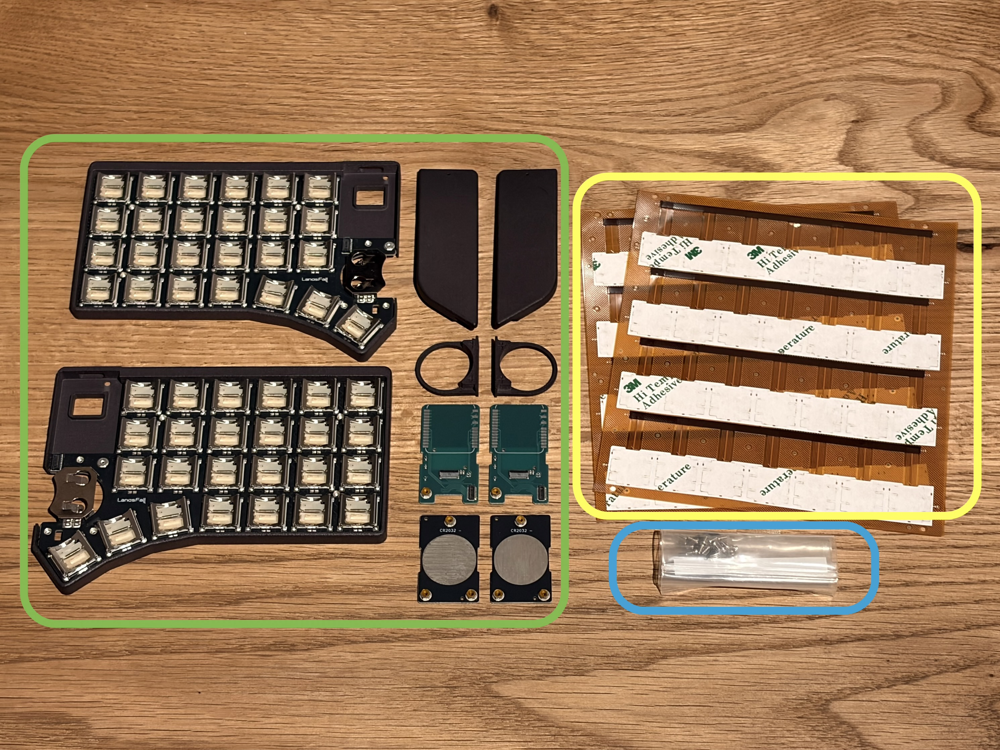

### 緑枠 — 基板・ケース

キットは仮組みした状態で届きます。以下の手順で左右両方を分解し、不足や破損がないか確認してください。

**1. トップカバーのテープを剥がす**

**2. 電池ケース・電池基板を取り外す**

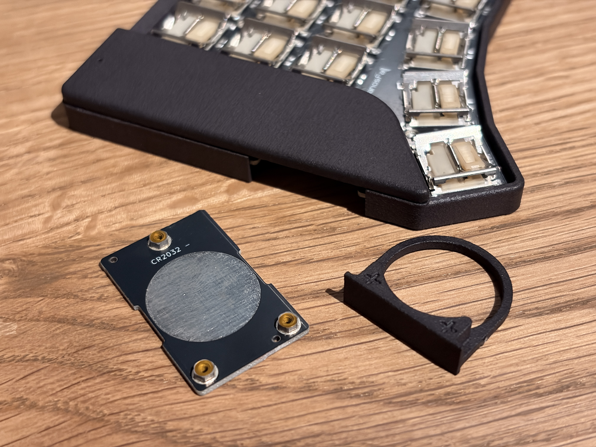

**3. トップカバーを取り外す**

写真の方向にトップカバーを少しスライドさせ、真上に持ち上げます。

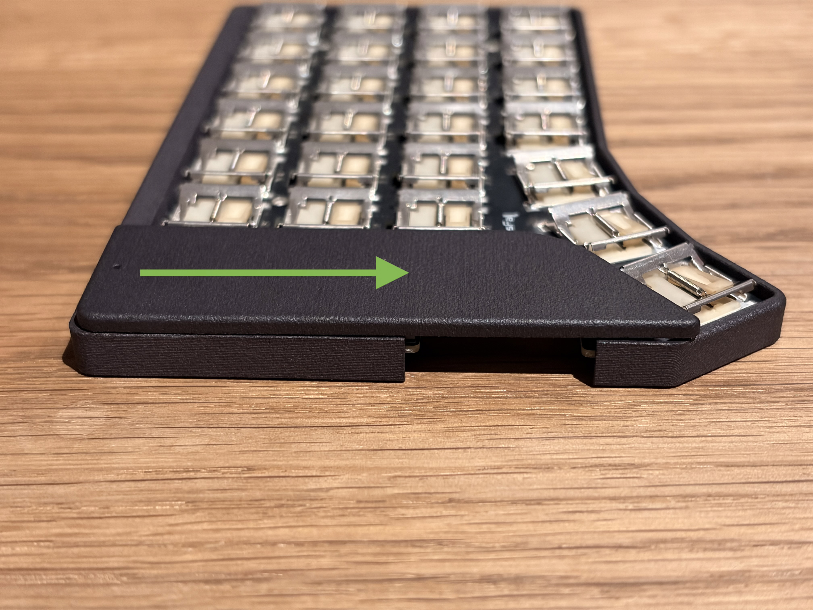 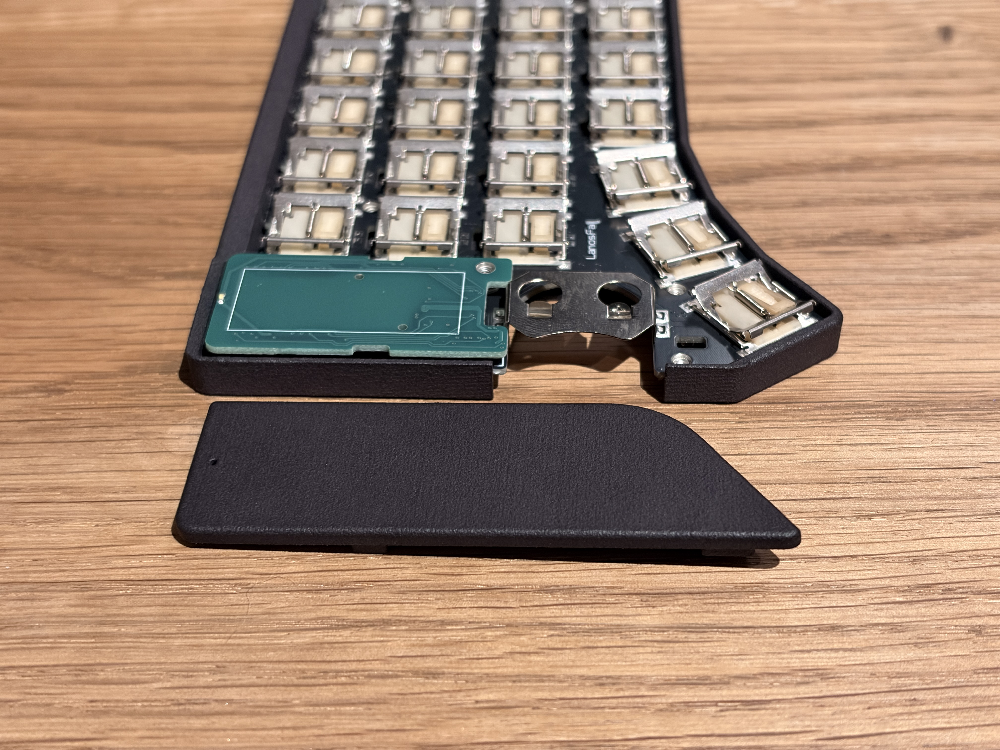

**4. メイン基板をケースから取り出す**

写真の順に、キースイッチが実装されているメイン基板を持ち上げ、ケースから取り出します。

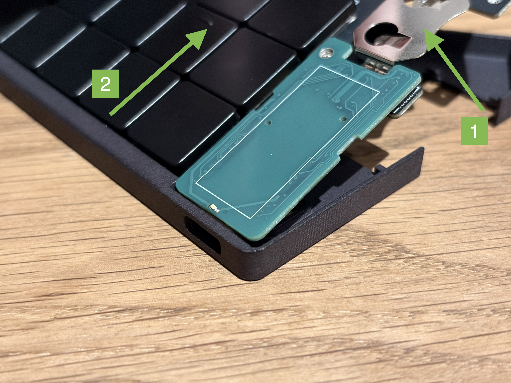 

### 黄枠 — タッチセンサーの親基板

タッチセンサーの親基板が2枚あることを確認してください。

### 青枠 — ネジ・その他

| 部品 | サイズ・仕様 | 数量 |
| --- | --- | ---: |
| 磁石 | φ10 × 1 mm | 8個 |
| 磁石 | φ3 × 2 mm | 2個 |
| ネジ（太・短） | M1.6 × 3 mm | 8本＋予備1本 |
| ネジ（細・短） | M1.2 × 3 mm | 6本＋予備1本 |
| ネジ（細・長） | M1.2 × 5 mm | 2本＋予備1本 |
| 滑り止めシート | 約6 × 50 mm、グレー | 1枚 |
| 吸音シート | フィルム付箋 | 25枚 × 2組 |

## 2. XIAO nRF52840 Plusのはんだ付け

XIAO nRF52840 Plusを、キットに付属する緑色のXIAO基板にはんだ付けします。XIAO基板は左右共通です。以下の手順を2枚とも行ってください。

**1. メイン基板からXIAO基板を取り外す**

XIAO基板を写真の矢印の方向にまっすぐ持ち上げ、コネクタから外します。

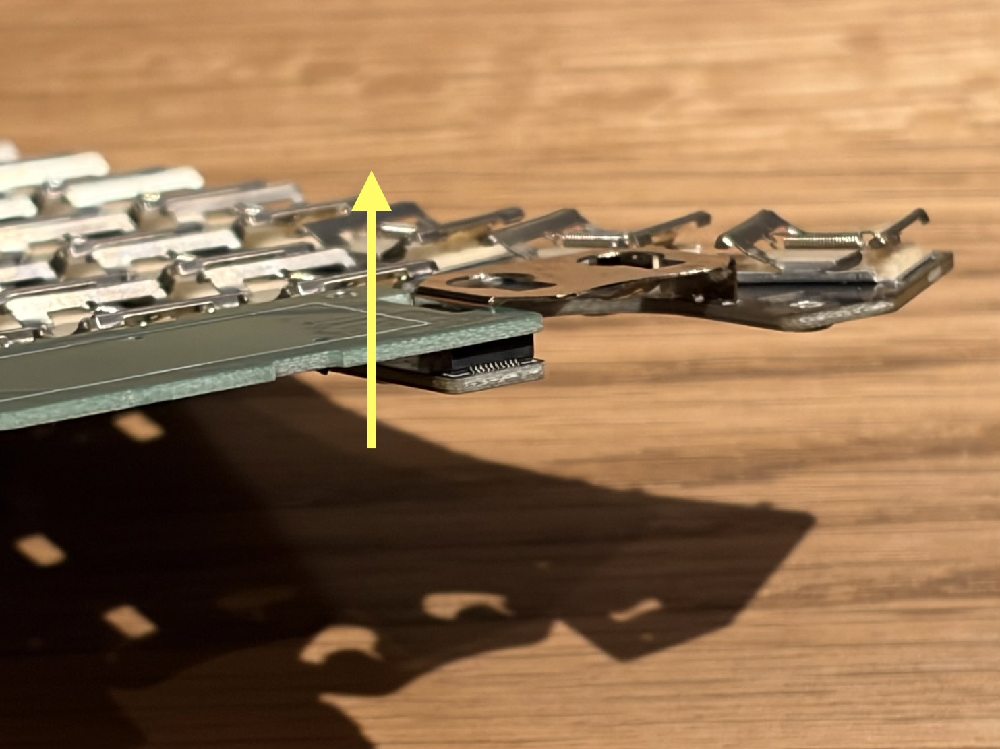

**2. XIAO nRF52840 Plusの位置決めを行う**

XIAO基板の印刷マーク（シルク印刷）を目印に、XIAO nRF52840 Plusの端子と実装用パッドの位置を合わせます。

**3. XIAO nRF52840 Plusをはんだ付けする**

まず四隅のうち1か所をはんだ付けし、XIAO nRF52840 Plusの位置を固定します。

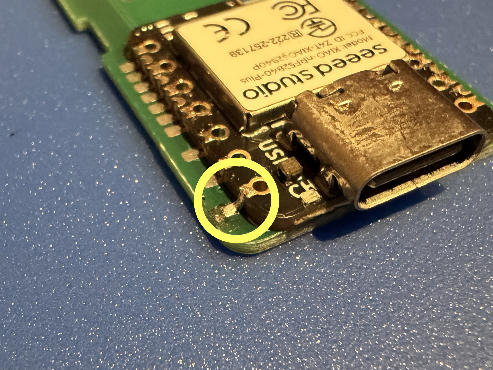

XIAO nRF52840 Plusのすべての側面端子をはんだ付けします。

https://github.com/user-attachments/assets/f41f2cdf-cf8f-4341-8282-2b132139bbb9

はんだ付け不良の例

- **黄色の矢印**：はんだが足りず、導通しない可能性があります。
- **赤色の矢印**：はんだが多すぎて、隣のパッドとつながっています（はんだブリッジ）。

## 3. タッチセンサーの取り付け

キーキャップの裏面にタッチセンサーを取り付けます。
格子状に並ぶオーソリニア配列部分の44キーすべてに、以下の手順を繰り返してください。

**1. 親基板からタッチセンサーを切り離す**

親基板から切り離した子基板を、以降はタッチセンサーと呼びます。動画のように、白い剥離紙が付いている側から先に切り離し、タッチセンサーの細い端に向かって取り外してください。

https://github.com/user-attachments/assets/fb06946d-4bcb-41b0-837e-7275ee3c5a9a

**2. 切り離したタッチセンサーから剥離紙を剥がす**

剥離紙はサムクラスタ用のキーキャップを準備するときに使います。**6枚以上**残してください。

https://github.com/user-attachments/assets/670d74a3-f58f-4339-be7a-0719ba9cc12a

**3. キーキャップの裏面にタッチセンサーを仮止めする**

動画を参考に、タッチセンサーの端をキーキャップの内側の壁に沿わせます。粘着面が裏面からはみ出さない位置で、軽く押さえて仮止めしてください。
1Uホーミングキーキャップを使う場合は、突起の向きも確認してください。タッチセンサーの細い部分が突き出ていない側が、使用時の手前です。

タッチセンサーの細い部分は、取り付けた状態で約90°曲がります。

https://github.com/user-attachments/assets/6732cb8c-c12d-4693-bf88-934a42c0de7a

タッチセンサーの貼り付け位置がずれた場合

貼り付け位置がずれると、キーを押せなくなったり、トラックパッドが反応しなくなったりすることがあります。タッチセンサーを剥がして貼り直してください。粘着剤が残ったり、タッチセンサーが破損したりした場合は、同梱の予備を使ってください。

**4. タッチセンサーを完全に貼り付ける**

木製の爪楊枝を使用して、タッチセンサーの四隅を中心に、キーキャップにしっかり密着させてください。

https://github.com/user-attachments/assets/e01d9a7d-bd10-44b0-b4d4-f7a53b401dd5

## 4. キーキャップの取り付け

格子状に並ぶオーソリニア配列部分の44キーすべてに、以下の手順を繰り返してください。

**1. 吸音シートを粘着面が外になるように半分に折る**

**2. 折り曲げた吸音シートを半分に切る**

折り曲がっている側だけを使用します。残りの切れ端は廃棄してください。

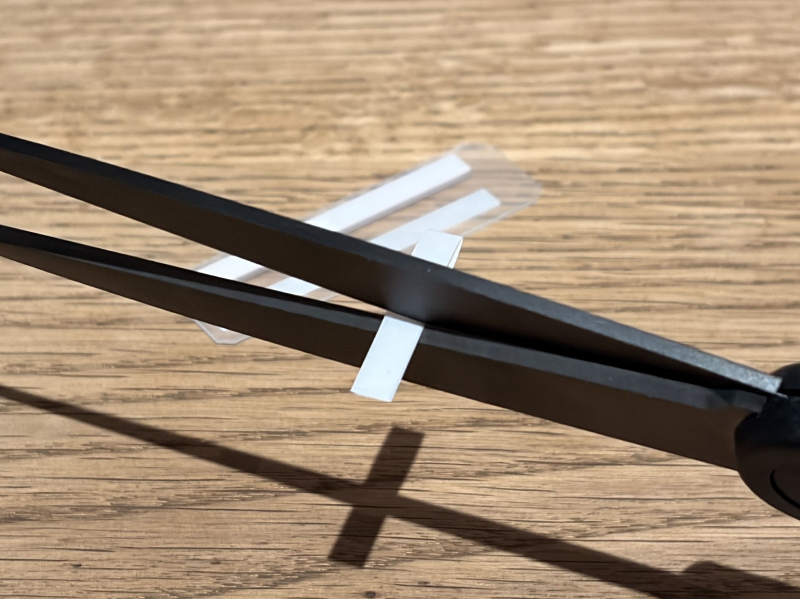

**3. キーキャップに吸音シートを貼り付ける**

写真の向きに、キーキャップの中央付近に吸音シートを貼り付けてください。

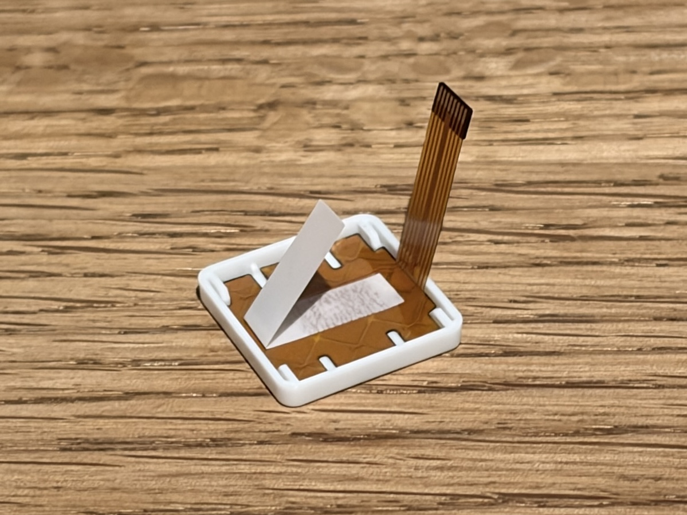

**4. キーキャップをメイン基板に取り付ける**

タッチセンサーの細い部分をキースイッチ上側にあるメイン基板の切り欠きに差し込み、吸音シートを巻き込まないように注意しながらキーキャップを押し込んで取り付けます。

https://github.com/user-attachments/assets/6ce605e7-47d3-441d-a133-7cb10b3fd03e

> [!WARNING]
> 吸音シートを巻き込んだ状態で取り付けると、キーが反応しにくくなります。

| 正常な取り付け | 吸音シートの巻き込み |
| --- | --- |
| 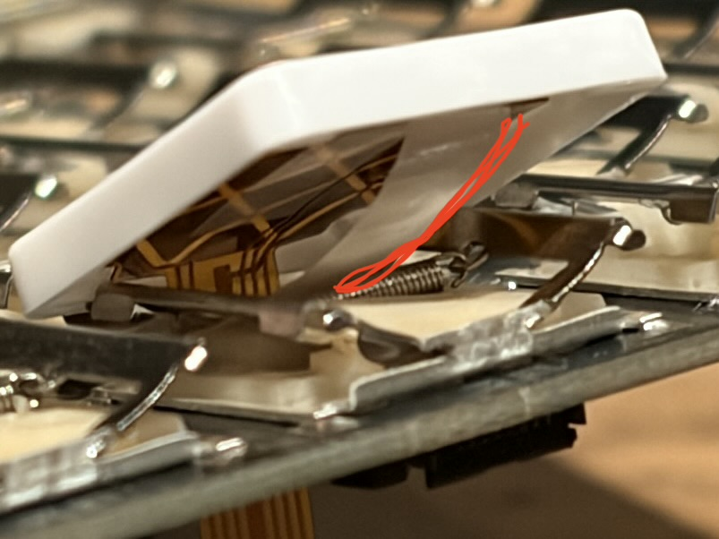 |  |

**5. タッチセンサーをメイン基板と接続する**

メイン基板背面のFPCコネクタのロックが上がった状態で、タッチセンサーをしっかり奥まで差し込み、そのままロックを下げて固定します。

https://github.com/user-attachments/assets/545d9d2c-6aa8-4b21-84b3-98e63c8cd9b2

> [!WARNING]
> FPCコネクタのロックを、タッチセンサーを差し込んでいない状態で繰り返し上げ下げしないようご注意ください。
> コネクタが故障する可能性があります。

ここまでで、オーソリニア配列部分のキーキャップの取り付けは完了です。

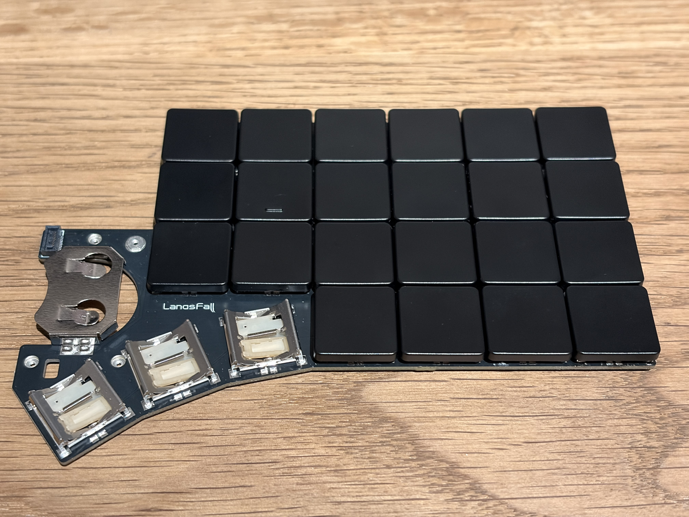

## 5. XIAO基板の取り付け

XIAO nRF52840 Plusをはんだ付けしたXIAO基板を、メイン基板のコネクタに差し込み、付属のネジ（細・短／M1.2 × 3 mm）で固定してください。左右両方で行います。

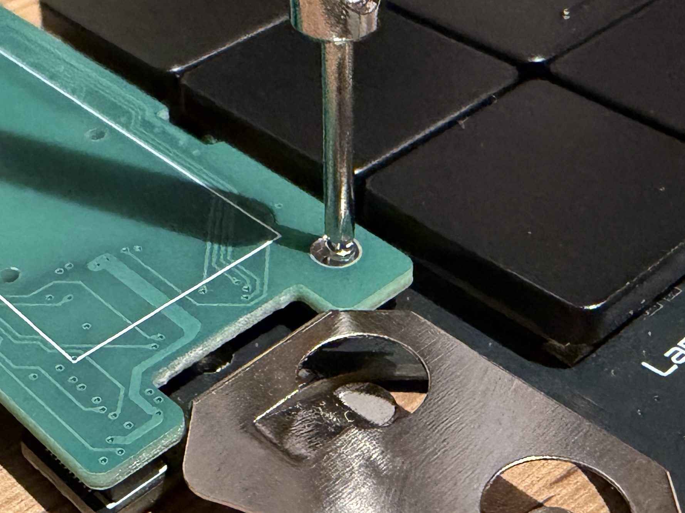

## 6. 磁石の取り付け

**1. 片方のケースに磁石を取り付ける**

まず左右どちらか一方のケースを選び、磁石を取り付けるくぼみを確認します。

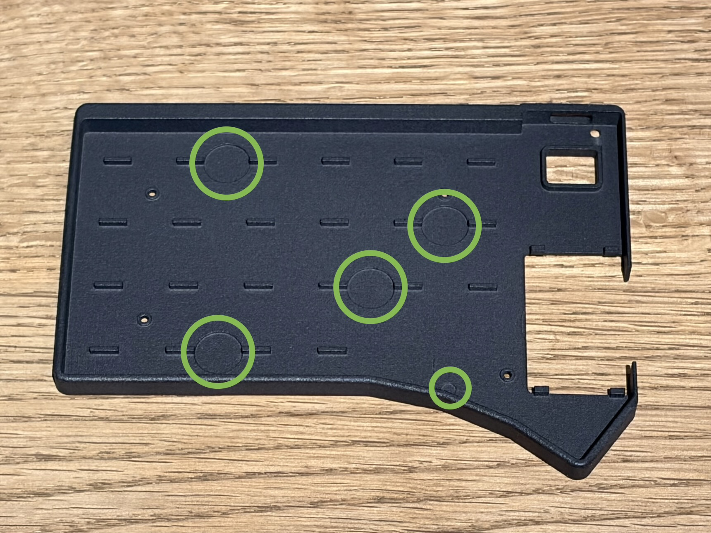

アロンアルファなどの接着剤を少量塗布して、磁石をくぼみに収まるように接着します。
最初に取り付ける側では、磁石の極性はどちら向きでも構いません。

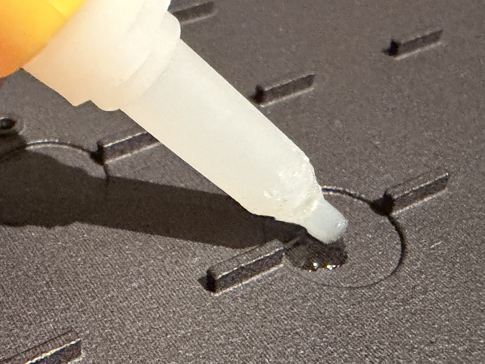

**2. もう片方のケースにも磁石を取り付ける**

前の手順で取り付けた磁石の接着剤がある程度硬化した後、もう片方のケースが上になるように背面同士を重ねます。

前の手順と同様に接着剤を塗布し、**最初に取り付けた側の磁石と吸着する向きに**φ10 mmの磁石4個を接着してください。
φ3 mmの磁石は、どちら向きでも構いません。

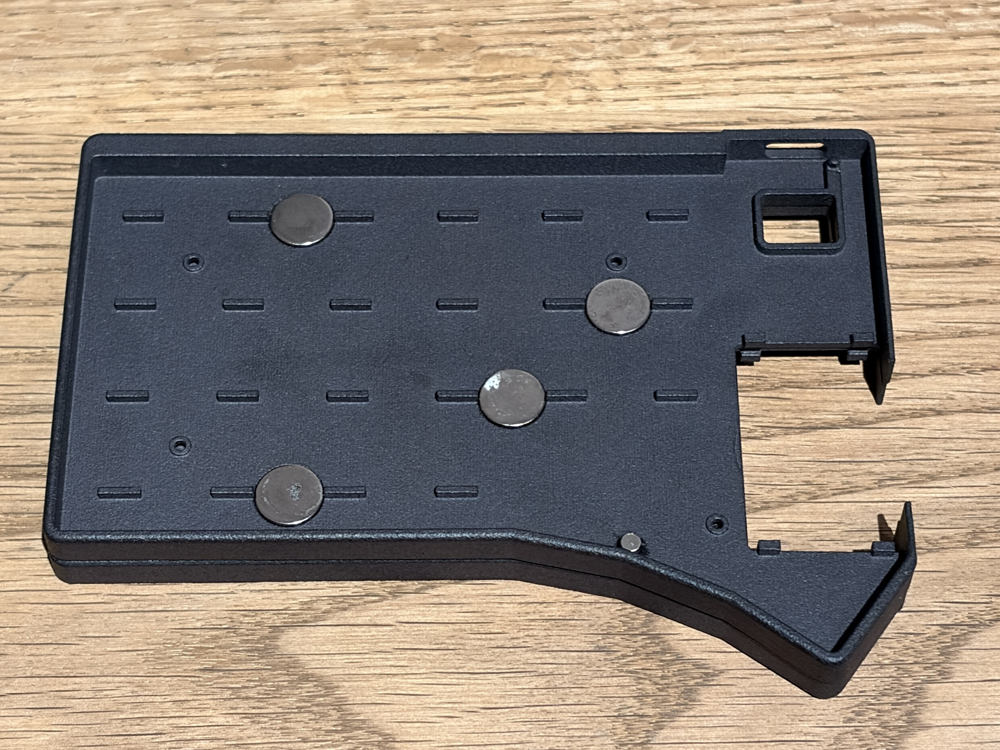

**3. 接着剤が硬化するまで待つ**

## 7. メイン基板と電池基板の固定

以下の手順を左右両方で行ってください。

**1. メイン基板をケースに戻す**

XIAO基板を固定したメイン基板を、取り外したときと逆の手順でケースに戻します。

**2. メイン基板をネジで固定する**

メイン基板が落ちないように押さえながらケースを裏返し、付属のネジ（太・短／M1.6 × 3 mm）4本で固定します。

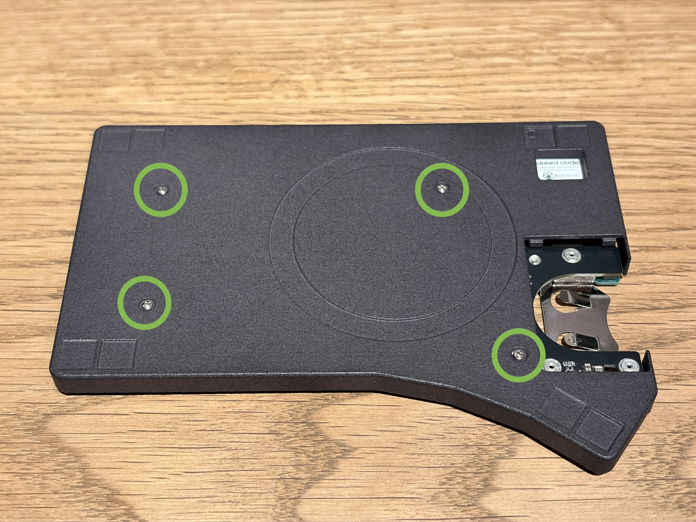

**3. 電池基板をネジで固定する**

電池基板を写真の向きに配置してください。
左右それぞれ、写真の**緑丸の2か所**を付属のネジ（細・短／M1.2 × 3 mm）で固定します。**赤丸の穴**は、トップカバーを固定するときに使うため空けておきます。

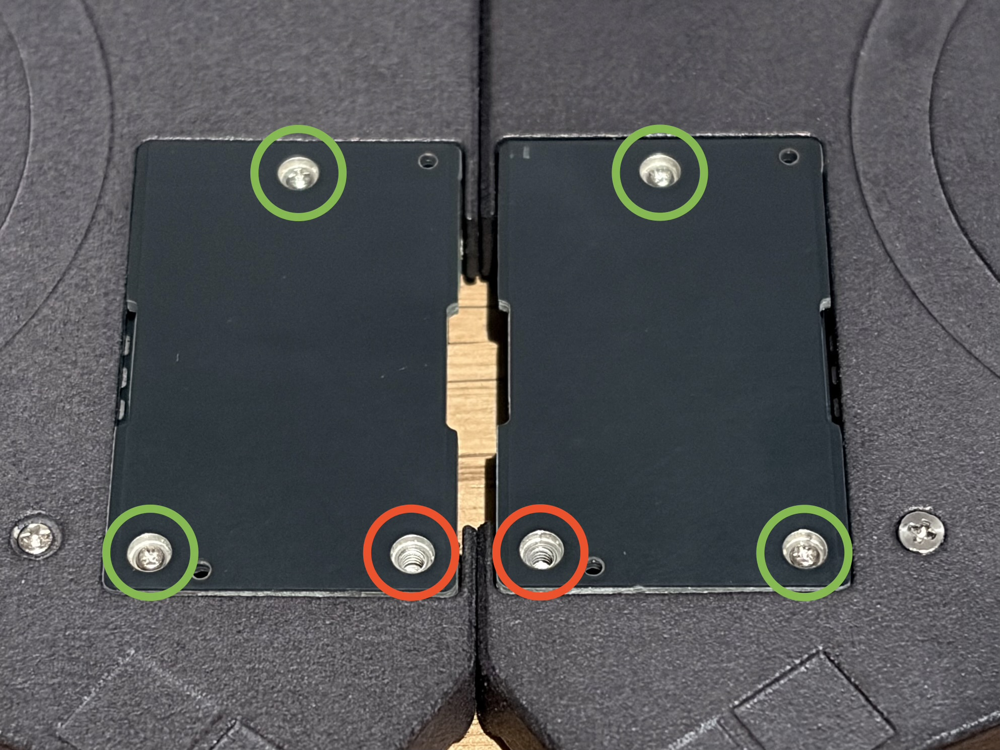

## 8. トップカバーの取り付け

以下の手順を左右両方で行ってください。

**1. トップカバーを取り付ける**

カバーの上端がケースの上端より約1 mm下になる位置で、真上からはめ込みます。カバーを上方向にスライドさせ、上端同士を揃えてください。

 

**2. トップカバーをネジで固定する**

前の手順で電池基板にネジを取り付けなかった箇所に、付属のネジ（細・長／M1.2 × 5 mm）を取り付けます。
ネジが最後まで入らなかったり、カバーが浮いたりする場合は、無理に締め込まず、カバーの位置を確認してください。

**3. トップカバーが固定されていることを確認する**

ネジを締めたあと、トップカバーが取り外す方向にスライドしないことを確認してください。

## 9. 滑り止めの貼り付け

**1. 滑り止めシートを切り分ける**

付属の滑り止めシート（約6 × 50 mm）を、約6 mm間隔で8片に切り分けます。
定規とペンで事前に目盛りをつけておくことをおすすめします。

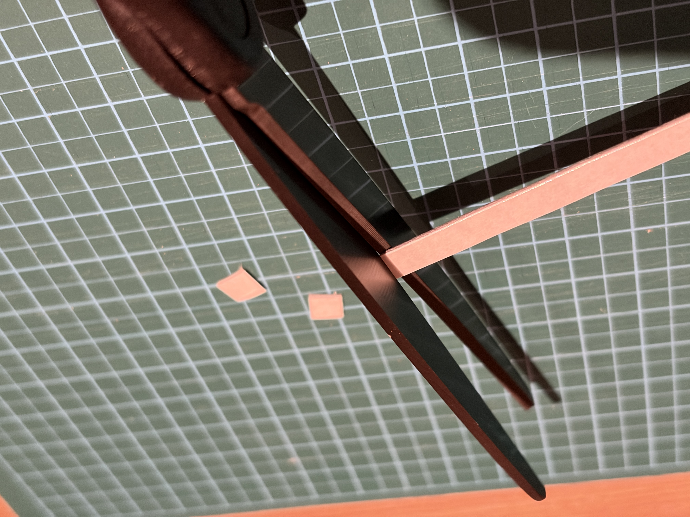

**2. 滑り止めシートを貼り付ける**

ケース背面の四角形のくぼみのうち、浅い方に滑り止めを貼り付けます。
貼り付け箇所をティッシュ等で清掃し、ゴミや埃を取り除いてください。

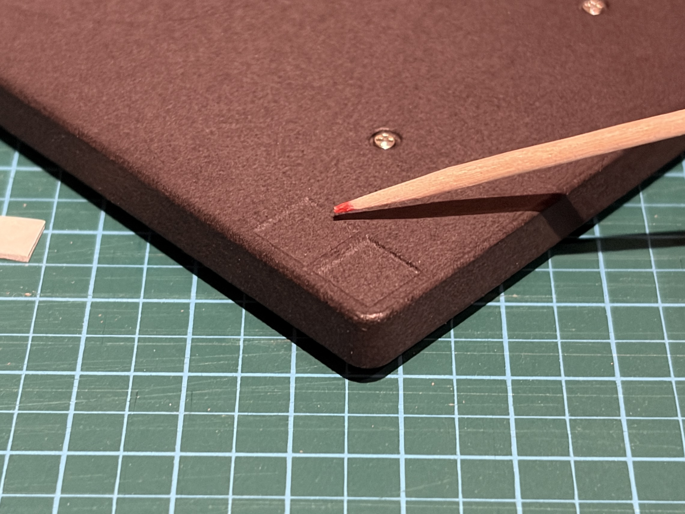

滑り止めシートの白い剥離紙を剥がして貼り付けてください。反対側の透明フィルムも剥がしてください。

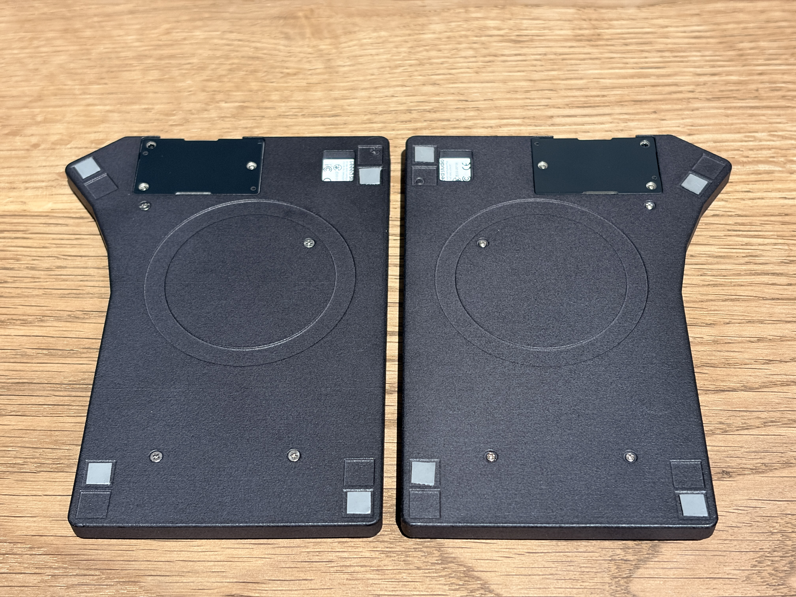

## 10. 動作確認

**1. ファームウェアをダウンロードする**

トラックパッドとして使う側を選び、リンク先の左右2つの `.uf2` ファイルをダウンロードしてください。

- **右手側をトラックパッドとして使う場合**：[右手用ファームウェア](firmware/trackpad_right)
- **左手側をトラックパッドとして使う場合**：[左手用ファームウェア](firmware/trackpad_left)

> [!NOTE]
> ファームウェアのリポジトリを後日公開予定です。

**2. ファームウェアを書き込む（左右両方）**

PCとキーボードをUSBケーブルで接続し、ケース背面の穴に爪楊枝などを差し込みXIAO nRF52840 Plusのリセットスイッチを素早く2回押し、ブートローダーを起動します。

`XIAO-BOOT`というドライブ名がPCに認識されたら、左手側にはファイル名に `left` を含むもの、右手側には `right` を含むものを、それぞれ対応するドライブにコピーしてください。
書き込みが終了するとドライブが自動で取り外されるので、USBケーブルを取り外してください。

**3. 電池を取り付ける（左右両方）**

CR2032をキーボード底面側がマイナス側になる向きで1つ挿入してください。

2つ目のCR2032を電池ホルダーに写真の向きで取り付け、キーボード底面側に1つ目の電池と重ねる形で挿入してください。

**4. LandsFall Harbourに接続する**

[LandsFall Harbour](https://chalan-175.github.io/LandsFall-Harbour/#/setup/keys)をChromeまたはEdgeで開き、トラックパッドとして使う側をUSBケーブルでPCに接続してください。
画面の指示に従って接続し、初期設定ページを開いてください。

ペリフェラル未接続の警告が出る場合

ペリフェラル側はUSBケーブルを外した状態にします。左右のケースの背面同士を磁石でくっつけ、少し待ってから引き離し、ペリフェラル側のLEDを確認してください。

- **数秒点滅してから約1.5秒おきに1回点滅する場合**：起動は問題ありません。[リセット用ファームウェア](firmware/settings-reset-xiao-ble-zmk.uf2)を左右両方に書き込み、他の電源が入ったXIAO nRF52840やZMK系キーボードが近くにない環境で、再度トラックパッドとして使う側に対応するファームウェアを書き込んでください。
- **数秒点滅してから完全消灯する場合**：ペアリングは正常と思われます。LandsFall Harbourのページを再読み込みしたり、キーボードを接続し直したりしても改善しない場合は、BOOTHの注文履歴からお問い合わせください。
- まったく点灯しない場合
  - **USBケーブルを挿してPCまたはUSB充電器に接続すると点滅する場合**：電池が正しい向きに入っているか確認してください。使いかけの電池の場合は、残量が少なく起動できない場合があるため、新品の電池を試してください。改善が見られない場合は、初期不良の可能性があるため、症状をBOOTHの注文履歴からご連絡ください。
  - PCとUSBケーブルで有線接続しても変化がない場合
    - **PCにUSBデバイスとして認識される場合**：XIAO nRF52840 Plusのはんだ付け不良が疑われます。XIAO基板を取り出し、はんだ付け状況を確認してください。
    - **PCにUSBデバイスとして認識されない場合**：ファームウェアの書き込み失敗や、XIAO nRF52840 Plusの故障が疑われます。ファームウェアの書き込み直しても改善しない場合、症状をBOOTHの注文履歴からご連絡ください。

**5. キーの反応を確認する**

「キーの反応確認」タブを開き、すべてのキーを順に押してチェックマークが付くことを確認してください。
サムクラスタキーはキーキャップ未取り付けのため、けがに注意しながらキースイッチを直接押してください。

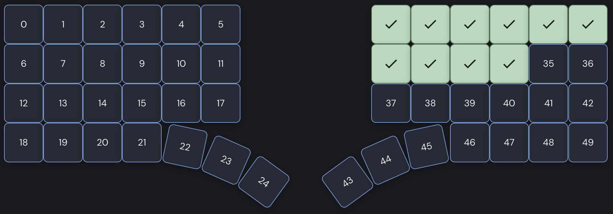

反応しないキーがある場合

- **特定の行または列がすべて反応しない場合**：XIAO nRF52840 Plusのはんだ付け不良の可能性があります。XIAO基板を取り外し、はんだ付け状況を確認してください。
- **特定のキーが反応しない場合**：キーの押下感が他と異なる場合、キーキャップの取り付けに異常がある可能性があります。

**6. タッチセンサーの接続を確認する**

「トラックパッドの確認」タブを開き、オーソリニア配列部分のすべてのキーにチェックマークが付くことを確認してください。

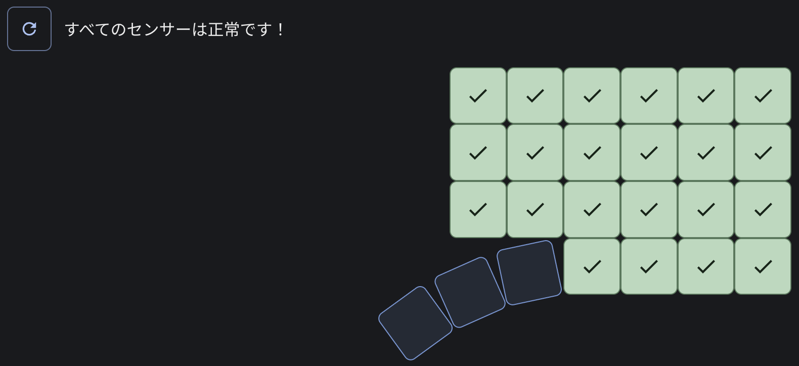

トラックパッドの確認でチェックマークが付かない場合

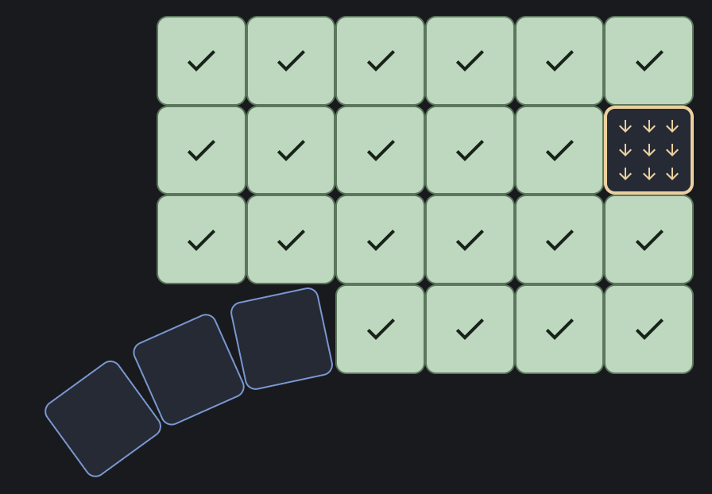

該当するキーのタッチセンサーがメイン基板に正しく接続されていない可能性があります。メイン基板を取り外し、タッチセンサーが背面のFPCコネクタに奥まで差し込まれ、ロックが下がっていることを確認してください。
タッチセンサーに破損が見られた場合は、キーキャップを取り外して予備のタッチセンサーに交換してください。

**7. トラックパッドの反応を確認する**

LandsFall Harbourの初期設定ページから離れ、左右いずれかのサムクラスタの一番内側のキーを押した状態で、トラックパッド上で指を滑らせてPCの操作ができることを確認してください。
操作ができず、セントラル側のLEDが素早く点滅している場合は、サムクラスタキーを押したままトラックパッドから数秒指を離し、点滅が消えるか確認してください。
点滅が消えた状態で操作できれば問題ありません。

## 11. サムクラスタキーの取り付け

**1. 静音化のためにキーキャップを準備する**

タッチセンサーを取り付けていない左右計6キーの裏面に、タッチセンサーの取り付け時に残しておいた剥離紙を置きます。

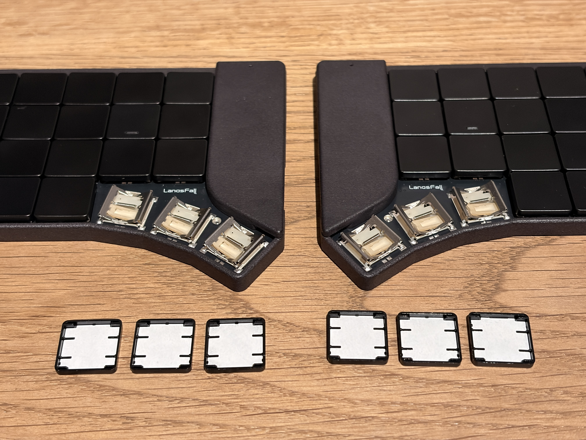

オーソリニア配列部分のキーキャップと同様に、吸音シートを剥離紙に貼り付けます。

**2. キーキャップを取り付ける**

吸音シートの向きをオーソリニア配列部分のキーキャップと揃え、キーキャップをはめ込んでください。

## 12. 完成！

LandsFallの組み立ては完了です。[LandsFall Harbour](https://chalan-175.github.io/LandsFall-Harbour/#/setup/keys)で、キーマップやトラックパッドの操作感を調整できます。キーマップはZMK Studioでも編集できます。

> [!TIP]
> - LandsFallのトラックパッドは、レイヤー1・2を除く任意のレイヤーで有効化されます。デフォルトではレイヤー6・7で有効となります。
> - トラックパッドの慣性スクロールやカーソル加速の設定は、Windows以外のOSで有効です。Windowsではタッチパッドとして認識され、感度やジェスチャーの設定はOS設定から行う必要があります。
